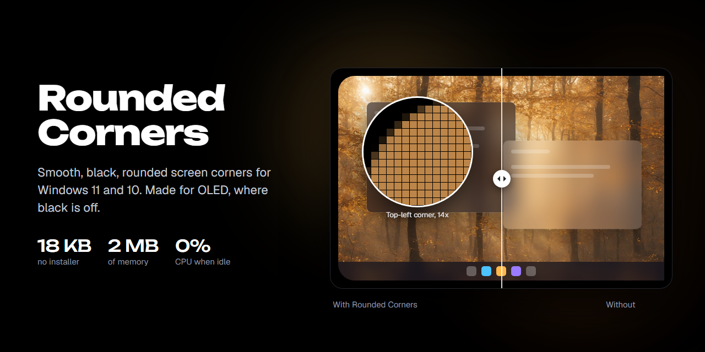
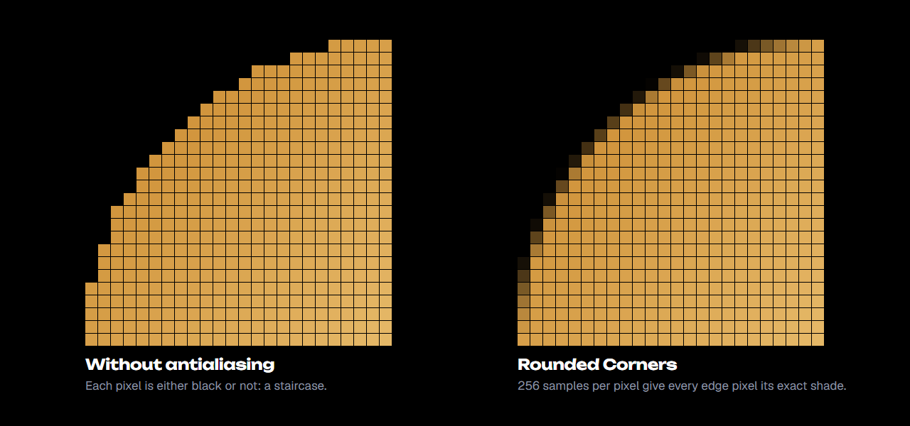
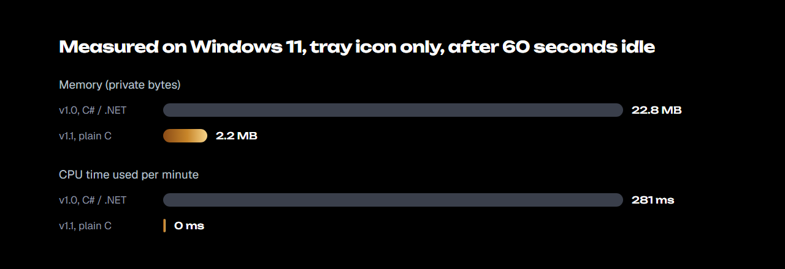

<p align="center">
  
</p>

<h1 align="center">Rounded Corners for Windows</h1>

<p align="center">
  <b>Round the corners of your screen on Windows 11 and Windows 10.</b><br>
  Smooth, antialiased black corners for OLED and every other display. 18 KB, 2 MB of memory, no CPU when idle.
</p>

<p align="center">
  <a href="https://github.com/AbhiramJayasankar/rounded-corners/releases/latest"></a>
  
  
  <a href="LICENSE"></a>
</p>

Rounded Corners draws a small black, antialiased corner over each corner of every monitor, so a sharp rectangular screen looks like a modern phone or laptop display. On an OLED screen the corners are pixels that are switched off, so they look like part of the bezel.

It's a single 18 KB program written in plain C against the Win32 API. There's no installer, no .NET or runtime to install, and nothing running in the background except the corners themselves.

## Features

- **Smooth, antialiased edges.** Every edge pixel gets its exact shade from 256 samples, so the curve has no jagged steps and no thin line along the screen edge.
- **Identical corners.** One corner is rendered and mirrored to the other three, so all four are pixel-identical.
- **Tiny footprint.** About 2 MB of memory and 0% CPU while idle. Nothing polls in the background: the corners only move back to the top when another window or the taskbar takes their place.
- **Click-through.** The corners never take focus or block the mouse, and they stay out of Alt+Tab and the taskbar.
- **Always on top**, including over an auto-hiding taskbar when it slides in.
- **Every monitor.** It redraws the corners when you plug in a display, change resolution or change scaling. Per-monitor DPI aware.
- **Adjustable radius** from 0 to 120 px with a slider (default 24 px), remembered between runs.
- **Lives in the tray.** Double-click the tray icon for Settings, or right-click it for Settings and Exit.

## Antialiasing up close

<p align="center">
  
</p>

Each corner pixel is split into a 16 × 16 grid of samples, and the pixel's darkness is the share of samples that fall outside the curve. Edge pixels get partial shades of black, so the curve looks smooth at any radius. The pixels are drawn with per-pixel alpha in a layered window, so the corners blend with whatever is underneath.

## Light on resources

<p align="center">
  
</p>

Version 1.0 was a C# WinForms app that checked the corners four times a second. Version 1.1 is a rewrite in C with no runtime. Instead of polling, it listens for Windows events: when the foreground window changes, or when the taskbar shows, moves or changes order. Measured on Windows 11 with the process's own counters, after 60 seconds idle in the tray:

| | v1.0 (C# / .NET) | v1.1 (C) |
|---|---|---|
| Download | 11.5 KB (needs .NET Framework) | 18 KB, self-contained |
| Memory (private bytes) | 22.8 MB | 2.2 MB |
| Working set | 36.4 MB | 2.4 MB |
| CPU time per minute idle | 281 ms | 0 ms |

## Download and run

1. Download `RoundedCorners.exe` from the [latest release](https://github.com/AbhiramJayasankar/rounded-corners/releases/latest).
2. Run it. Choose a radius in the window that opens, then close the window or click **Hide to tray**.
3. To start it with Windows, press <kbd>Win</kbd> + <kbd>R</kbd>, type `shell:startup`, and put a shortcut to `RoundedCorners.exe` in that folder.

Opening the program again while it's running brings up the existing Settings window. It doesn't start a second copy. Your radius is saved in `%APPDATA%\RoundedCorners.cfg`.

Windows SmartScreen may warn about an unsigned download. Click **More info** and then **Run anyway**, or build it yourself from the source below.

## Build from source

You need the Visual Studio Build Tools with the "Desktop development with C++" workload. From an *x64 Native Tools Command Prompt*:

```bat
build.cmd
```

`build.cmd` compiles `RoundedCorners.c` with `/O1`, links it without the C runtime (`/NODEFAULTLIB`, custom entry point), and embeds the icon, version info and manifest from `RoundedCorners.rc`. The result imports only `kernel32`, `user32`, `gdi32`, `shell32` and `comctl32`.

The README images come from the HTML in [`docs/art`](docs/art). They use the same coverage math as the app.

## Known limitation

When you press the <kbd>Win</kbd> key or open Start, Windows moves the taskbar into a system layer that sits above every app's always-on-top windows. While Start is open, the bottom corners are covered by the taskbar. They return as soon as Start closes. No regular app can draw over that layer; only Windows shell components can.

## FAQ

**Does it work on Windows 10?** Yes. It needs Windows 10 version 1607 or newer, for per-monitor DPI support.

**Does it affect games or performance?** No. The corners are four tiny layered windows per monitor that the compositor draws. The app does no work while idle.

**Does it work with multiple monitors?** Yes. Every monitor gets four corners, and they are rebuilt when the display layout changes.

**How do I uninstall it?** Right-click the tray icon and choose **Exit**, then delete the exe, any shortcut you made in `shell:startup`, and `%APPDATA%\RoundedCorners.cfg`.

## License

[MIT](LICENSE)
